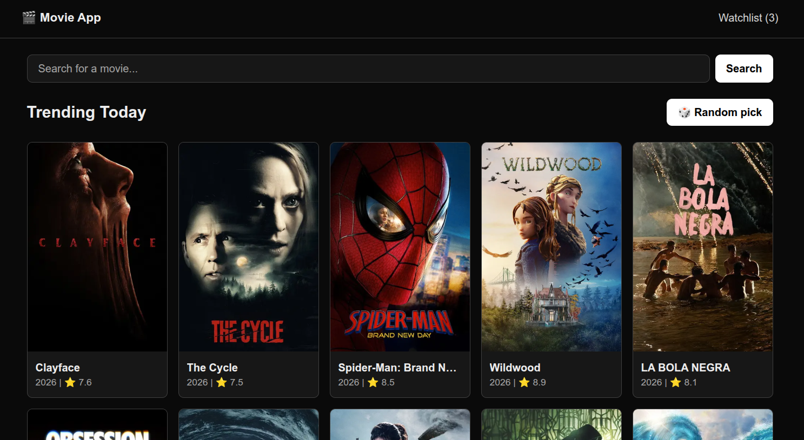
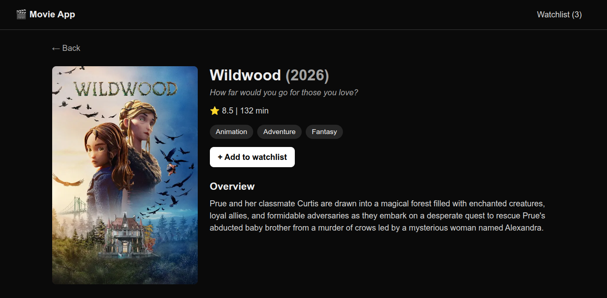
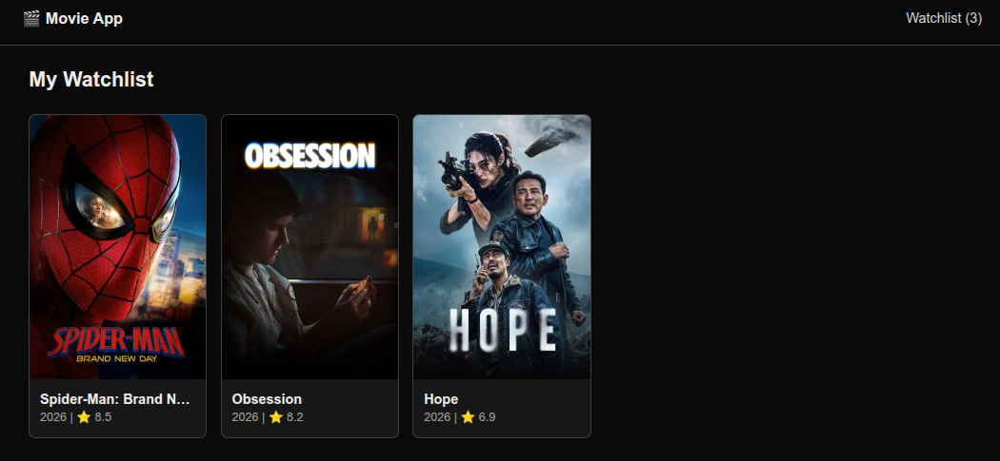
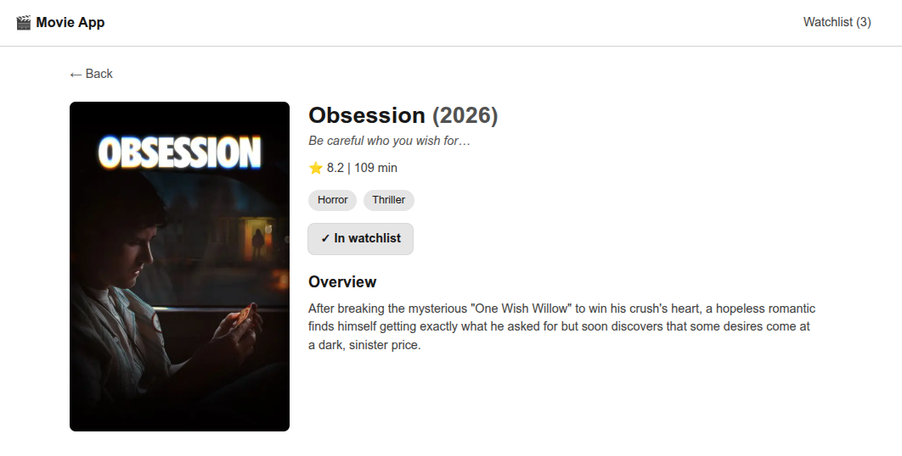
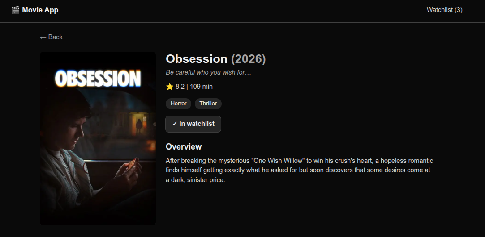

# Movie App

A movie discovery app where you can browse what's trending, search for any movie, watch trailers, see the cast, save movies to a watchlist, or let the app pick something for tonight.



**Details page**

| Overview | Trailer | Cast |
|---|---|---|
|  |  |  |

| Watchlist | Light Theme | Dark Theme |
|---|---|---|
|  |  |  |

## Features

- **Trending today:** the home page shows what's trending, with posters, year, and rating.
- **Search:** the search term lives in the URL (`/search?q=batman`), so results can be refreshed, bookmarked, and shared.
- **Details page:** poster, tagline, genres, runtime, overview, embedded trailer, and top cast.
- **Watchlist:** save and remove movies, with a live count in the header. It's kept in the browser and stays in sync across tabs.
- **Random pick:** one click opens a random well-reviewed movie.
- **Loading, empty, error, and not-found states:** skeleton placeholders while data loads, friendly messages when there are no results, and a proper page for bad URLs.
- **Light and dark theme:** follows the device setting.
- **Responsive:** works on phones, tablets, and desktops.

## Tech stack

| Tool | Why I used it |
|---|---|
| Next.js 16 (App Router) | Server components let me call the API on the server, so the API key never reaches the browser. |
| TypeScript | Catches mistakes early, and the TMDB response shapes are written as types. |
| Tailwind CSS v4 | Fast styling, with color variables for the light and dark theme. |
| TMDB API | Free, large movie database with images, cast, and trailers. |

## Getting started

You need Node.js 20 or newer and a free [TMDB API key](https://www.themoviedb.org/settings/api).

```bash
git clone https://github.com/MariaEgbuna/movie-app.git
cd movie-app
npm install
```

Create a file called `.env.local` in the project root and add your key:

```
TMDB_API_KEY=your_key_here
```

Both TMDB key types work: the short API key, or the long "Read Access Token" (the app detects which one you used).

Then start the dev server:

```bash
npm run dev
```

Open [http://localhost:3000](http://localhost:3000).

| Script | What it does |
|---|---|
| `npm run dev` | Starts the dev server |
| `npm run dev:ipv4` | Starts the dev server with IPv4 preferred, for networks where Node times out (see "What I learned") |
| `npm run build` | Builds for production |
| `npm run start` | Runs the production build |
| `npm run lint` | Checks the code with ESLint |

## Project structure

```
app/
  layout.tsx            Page shell and header
  page.tsx              Home: search bar, random pick button, trending grid
  loading.tsx           Skeleton for list pages
  error.tsx             Friendly error page with a retry button
  not-found.tsx         Page for missing movies and bad URLs
  search/page.tsx       Search results
  movie/[id]/page.tsx   Details page
  movie/[id]/loading.tsx  Skeleton for the details page
  watchlist/page.tsx    Saved movies
  random/route.ts       Picks a random movie and redirects to it
components/             Header, MovieCard, MovieGrid, SearchBar, WatchlistButton, skeletons
lib/
  tmdb.ts               All TMDB requests, with retries and timeouts
  watchlist.ts          Watchlist saved in localStorage
```

## How it works

- **The API key stays on the server.** Pages are server components, and the key has no `NEXT_PUBLIC_` prefix, so it is never sent to the browser.
- **One place for API calls.** `lib/tmdb.ts` holds the base URL, the key handling, retries (3 attempts), and an 8 second timeout. A 404 from TMDB becomes a proper "not found" page, and other failures reach the error page.
- **Fewer requests.** The details page asks TMDB for the movie, cast, and trailers in a single request, and responses are cached for an hour.
- **Search uses a plain form** that goes to `/search?q=...`, so it works without client-side JavaScript.
- **The watchlist uses `useSyncExternalStore`** to read `localStorage`. That keeps the button, the header count, and the watchlist page in sync, and avoids a mismatch between the server and the browser.
- **The movie id from the URL is checked** (digits only) before it is used in an API request.

## What I learned

Problems I ran into and how I solved them:

- **Images didn't load after changing `next.config.ts`.** Next.js only reads that file at startup, so I needed to restart the dev server.
- **Requests to TMDB timed out from Node but worked in `curl`.** On a phone hotspot, Node 20 gave the IPv4 connection too little time before also trying IPv6 (which had no route). Starting Node with `--dns-result-order=ipv4first --no-network-family-autoselection` fixed it, and I added retries and a timeout so real users on weak connections get a friendly error instead of a crash.
- **`loading.tsx` was ignored.** I had created a second `app` folder inside `app`. Special Next.js files only work in the right place.
- **Parts of the UI were invisible in light mode.** My colors were fixed for a dark page. I replaced them with named color variables (`surface`, `muted`, `accent`, and so on) that have a light and a dark value.
- **The watchlist button did nothing when testing on my phone.** The dev server blocks scripts requested from other addresses, so I added my PC's address to `allowedDevOrigins`.
- **The random pick redirect sent my phone to `localhost`.** Redirecting with a relative path fixed it.

## Known limits and ideas

- The watchlist is saved per browser and device. A version with accounts and a database would fix that.
- Ideas for later: manual light/dark toggle, genre filter, search-as-you-type, TV shows.

## Credits

This product uses the TMDB API but is not endorsed or certified by TMDB. Movie data and images are provided by [The Movie Database (TMDB)](https://www.themoviedb.org/).
